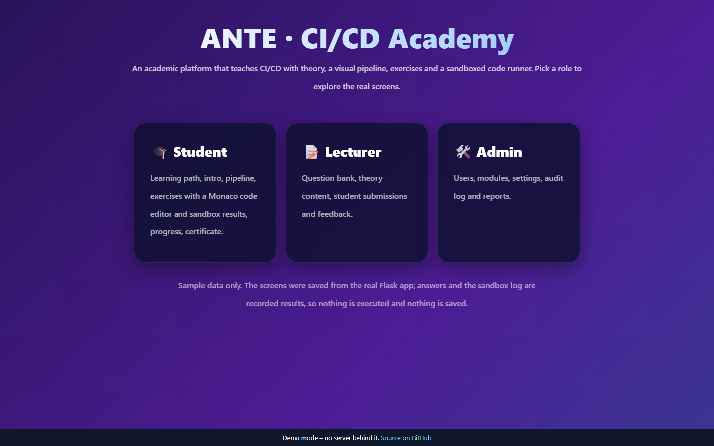
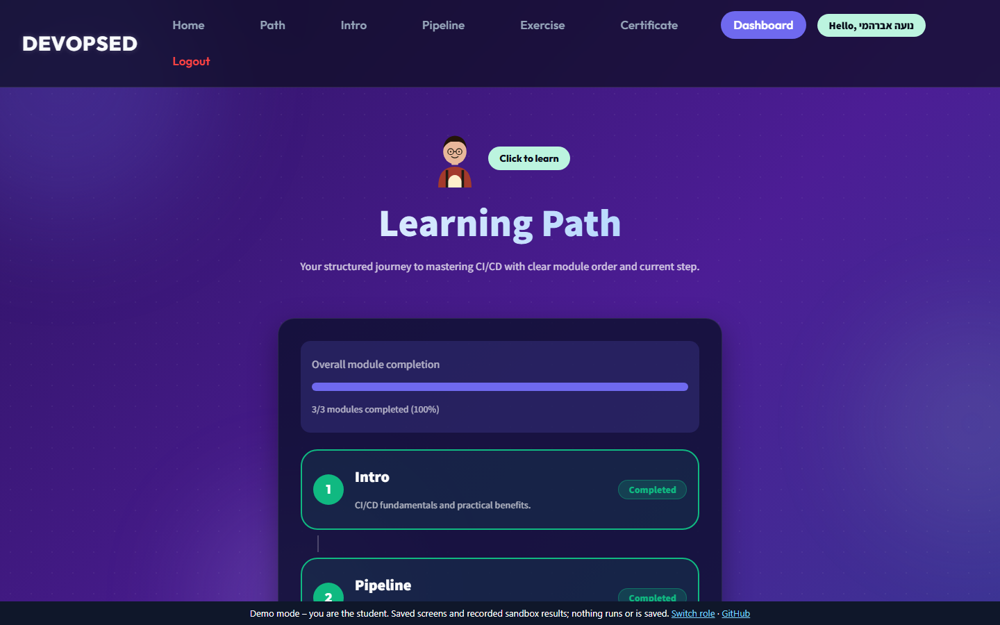
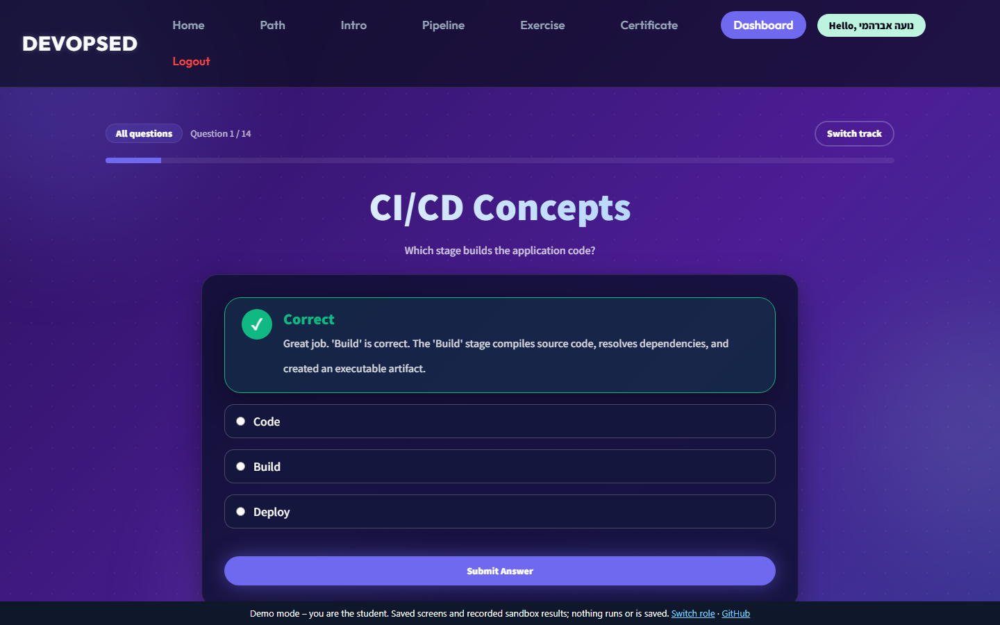
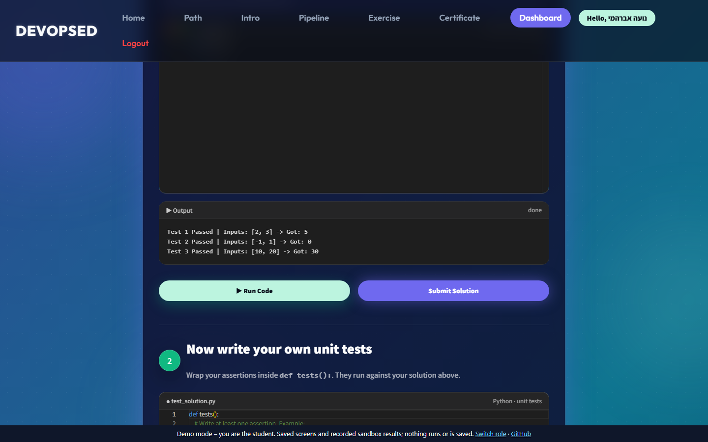
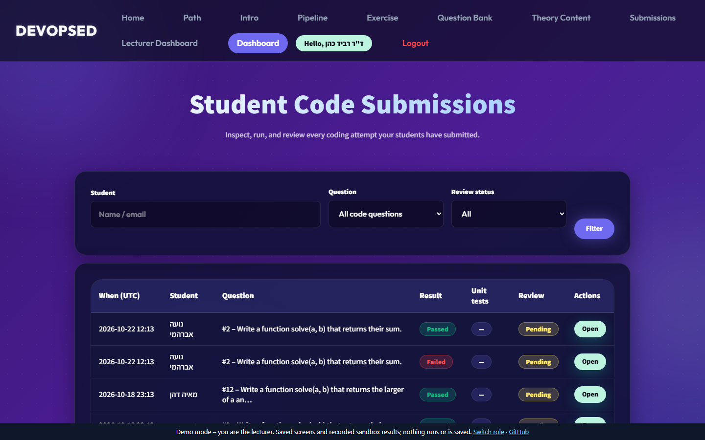
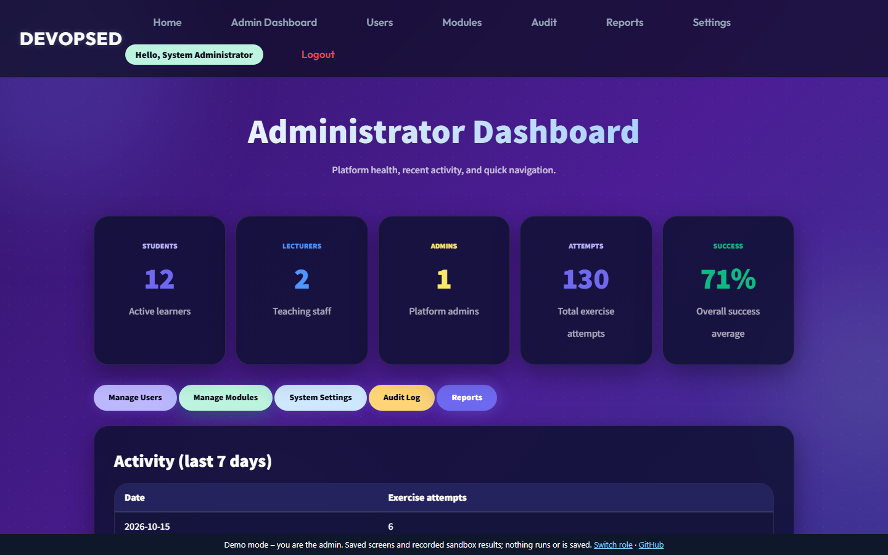
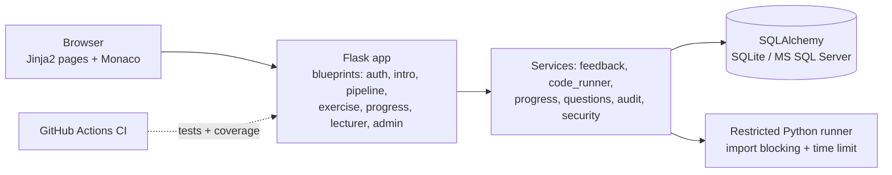

# ANTE — CI/CD Academic Learning Platform

An interactive web platform that teaches **CI/CD and DevOps** through practice: students read short theory, watch an animated *Code → Build → Test → Deploy* pipeline, solve quiz and coding exercises in an in-browser editor, and get automatic feedback. Lecturers manage the question bank and review submissions; admins manage users, modules and the audit log.


### [▶ Live Demo](https://saeedabuhani.github.io/BS-PMC-26-Team1/)

The live demo is a **static, no-server** version hosted on GitHub Pages (branch `gh-pages`). Its screens were saved from the real Flask app (student, lecturer and admin panels, with seeded sample data). Answers and the code runner's output are results **recorded** when the demo was built, so no code runs in the browser or on Netlify and nothing is saved. Pick a role on the first screen.

> Team project developed at Sami Shamoon College of Engineering (SCE) by a four-student team, as part of the course `BS-PMC-2026`. The full commit history of the team repository is preserved here.

| | |
|---|---|
|  |  |
|  |  |
|  |  |

## Features

- **Learning modules** (Intro, Pipeline, Exercise) with progress tracking and a learning path.
- **Exercises:** multiple choice, open questions and coding tasks, with instant feedback and explanations.
- **Embedded Monaco editor** (the VS Code editor) with Python highlighting, a **Run** button and a **sandbox** result log.
- **Student unit tests:** after solving a challenge, students write and run their own tests.
- **Animated CI/CD pipeline** simulation with terminal-style output.
- **Role-based panels:** student, lecturer (question bank, theory content, submissions review and feedback) and admin (users, modules, settings, audit log, CSV reports).
- **Completion certificate** generated as a PDF.
- **Security hardening:** CSRF tokens, login throttling, session timeout, audit log (details below).

## Architecture



## Tech stack

| Layer | Technology |
|---|---|
| Backend | Python 3.12, Flask 3 |
| Data | SQLAlchemy 2, SQLite (default), MS SQL Server (optional) |
| Frontend | Jinja2 templates, custom design system CSS, Monaco Editor (CDN) |
| Testing | pytest, pytest-cov, flake8 |
| CI/CD | GitHub Actions: build, test and coverage, plus an Azure deployment readiness check |

## Quick start

```bash
python -m venv venv
venv\Scripts\activate            # Windows (source venv/bin/activate on Linux/macOS)
pip install -r requirements.txt
python scripts/seed_demo.py      # optional: demo lecturers, 12 students and attempts
python app.py                    # then open http://127.0.0.1:5000
```

Open `/login`. With the demo data, the accounts below exist. Use them for local demos only.

## Demo credentials

Created by `python scripts/seed_demo.py` (the seeder also writes them to `DEMO_USERS.md`).

| Role | Email | Password |
|---|---|---|
| Admin | `admin@ante.local` | `Admin#12345` |
| Lecturer | `ravid.cohen@ante.local` | `Demo#12345` |
| Student | `noa.avrahami@ante.local` | `Demo#12345` |

Change these before any real deployment. Set `SECRET_KEY` in the environment; the code falls back to a development key otherwise.

## Tests

```bash
python -m pytest -v
python -m pytest --cov=app --cov-report=html
```

Result: **370 passed** locally and in GitHub Actions (coverage 83%). The workflow in `.github/workflows/ci.yml` runs the suite on every push and pull request.

## Static demo build

The public demo is generated from the real app:

```bash
npm i playwright && npx playwright install chromium
DEMO_BASE=/BS-PMC-26-Team1 node scripts/build_demo.mjs   # writes demo-dist/ for a GitHub Pages project site
```

Without `DEMO_BASE` the build is meant to be served from a site root. The `gh-pages` branch holds the contents of `demo-dist/`.

The script starts the app on a throw-away SQLite database, seeds it with `scripts/seed_demo.py`, signs in as a student, a lecturer and the admin with a headless browser, saves every reachable screen, and records the feedback pages and sandbox output once. `scripts/demo_runtime.js` then answers the forms and the Run button from those recordings in the browser.

## Security notes

- **CSRF** tokens on forms, **login throttling** (5 failed attempts lock the account for 15 minutes), **session timeout** (60 minutes) and an **audit log** of sensitive actions.
- Passwords are stored as salted hashes (Werkzeug). Role checks are enforced on the server for the student, lecturer and admin routes.
- **Code runner limits:** student code is checked for restricted imports and run with a reduced set of built-ins and a time limit. It runs inside a worker thread of the application process, so this is a teaching sandbox, **not** a security boundary. Before exposing the runner to untrusted users, move it into a separate container or process with real resource limits.
- No secrets are stored in the repository: the full git history was scanned with gitleaks (no findings). `SECRET_KEY` comes from the environment; the seeded demo passwords are for local use only.
- The public demo has no back end: nothing executes and nothing is stored.

## My role

Saeed Abu Hani, 132 of the 327 commits across all branches. Based on the commit history:

- **CI/CD pipeline**: created and maintained the GitHub Actions workflows (`ci.yml` for build, test and coverage, a hackathon workflow, and the Azure readiness check)
- **Repository structure**: reorganised the project layout (moving modules into `app/` and `app/services/`) and merged work between branches
- **Backend modules**: contributed to models, authorization, database initialisation and services (questions, progress, reports)
- **Documentation**: maintained the README

## Team

| Member | GitHub | Commits (all branches) |
|---|---|---|
| Saeed Abu Hani | [@abohaab-cell](https://github.com/abohaab-cell) | 132 |
| Borh2n | [@Borh2n](https://github.com/Borh2n) | 112 |
| Yosef Nsasra | [@yosef870](https://github.com/yosef870) | 43 |
| Yakoob Hasone | [@YakoobHasone](https://github.com/YakoobHasone) | 40 |

The original repository belongs to the course organisation `BS-PMC-2026` (`BS-PMC-26-Team1`). All credit for the shared work goes to the whole team.

## Roadmap

- Run the code runner in an isolated container or subprocess with enforced CPU and memory limits.
- Rate-limit the registration and password-reset endpoints as well as login.
- Deploy the Azure target already prepared in the CI readiness check.
- More lecturer analytics on student submissions.
